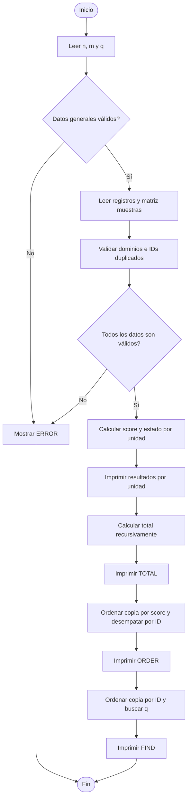

# PMC01 – Arranques de un ventilador con histéresis

## 1. Descripción del proyecto

El proyecto consiste en desarrollar un simulador en lenguaje C que permita evaluar el comportamiento de varias unidades de una celda mecatrónica a partir de una serie de muestras.

Cada unidad posee un identificador, un nombre, un tipo de configuración inicial y un parámetro de referencia (`p`). A partir de las lecturas recibidas, el programa calcula cuántas veces arranca el ventilador (`score`) y determina su estado final.

Además, el programa calcula la suma total de arranques, ordena las unidades según su puntuación y permite consultar el resultado de un identificador específico.

## 2. Objetivo

Implementar una solución en C11 que procese y valide los datos de múltiples unidades mecatrónicas, aplique las reglas de histéresis y presente los resultados correspondientes.

El desarrollo utiliza estructuras anidadas, arreglos, matrices, funciones, recursividad, ordenamiento y búsqueda binaria.

## 3. Datos de entrada

El programa recibe inicialmente tres valores:

| Variable | Descripción | Rango permitido |
|---|---|---|
| n | Cantidad de unidades | 1 a 20 |
| m | Cantidad de muestras por unidad | 1 a 8 |
| q | Identificador que se desea buscar | 1 a 9999 (opcional) |

Posteriormente, cada unidad contiene:

| Dato | Descripción | Restricción |
|---|---|---|
| id | Identificador | 1 a 9999, únicos |
| nombre | Etiqueta de la unidad | 1 a 15 caracteres alfanuméricos o guion bajo |
| tipo | Estado inicial | 0 (apagado) o 1 (encendido) |
| p | Parámetro de referencia | 0 a 100 |
| x | Valores de las muestras | Cada valor entre 0 y 100 |

## 4. Estructuras de datos

La implementación utiliza las siguientes estructuras obligatorias:

- **Matriz de muestras:** almacena los valores de cada unidad mediante `int muestras[20][8]`.
- **Estructura Configuracion:** almacena el `tipo` y el parámetro `p`.
- **Estructura Registro:** almacena el `id`, `nombre`, la `Configuracion` anidada, el `score` y el `estado`.

La definición de las estructuras y los prototipos de las funciones se encuentran en `reto.h`, mientras que la implementación del programa se encuentra en `main.c`.

## 5. Validación de datos

Antes de realizar los cálculos, el programa comprueba estrictamente que todos los datos cumplan las condiciones. Se verifican:

1. Los límites de `n`, `m`, `id`, `q`, `tipo`, `p` y `x`.
2. Que no existan identificadores (`id`) duplicados.
3. La forma léxica y tamaño de los nombres.
4. Que la entrada esté completa.

Si se detecta cualquier dato inválido, entrada incompleta o tokens extra, el programa imprime `ERROR` y termina de forma normal sin resultados parciales.

## 6. Lógica de simulación (Histéresis)

Cada unidad se procesa de manera completamente independiente (sin arrastrar memoria).

Para cada unidad, el estado actual inicia igual al `tipo` y el `score` inicia en `0`. Se recorren las muestras en orden aplicando estas reglas:

- **Encendido:** Si el ventilador está apagado (`estado == 0`) y la lectura es `x >= p + 10`, se enciende (`estado = 1`) y se suma 1 al `score`.
- **Apagado:** Si el ventilador está encendido (`estado == 1`) y la lectura es `x <= p`, se apaga (`estado = 0`).
- **Mantenimiento:** En los demás casos, conserva su estado actual.

Solo se permite una transición por muestra. El `estado` final de la unidad es si terminó encendido (1) o apagado (0).

## 7. Procesamiento de resultados

### 7.1. Cálculo del total
Se utiliza la función recursiva `total_rec` (con caso base n=0) para sumar todos los `score` de la matriz de registros.

### 7.2. Ordenamiento
Se implementa un algoritmo básico (burbuja, selección o inserción) para organizar las unidades sin usar `qsort`, ordenándolas por:
1. `score` en orden descendente.
2. En empate, por `id` en orden ascendente.
Se preserva el orden original para la primera parte de la salida.

### 7.3. Búsqueda binaria
La función `buscar` realiza una búsqueda binaria sin usar `bsearch` sobre una copia de los registros ordenados por `id`. Si `q` existe, devuelve su `score`; de lo contrario, devuelve `-1`.

## 8. Pseudocódigo general

```text
INICIO
    Leer n, m, q
    Validar rangos generales
    
    SI entrada general inválida ENTONCES
        Mostrar ERROR y TERMINAR
    FIN SI

    PARA cada unidad i de 0 a n-1 HACER
        Leer id, nombre, tipo, p
        Validar dominios y buscar ids duplicados
        
        PARA cada muestra j de 0 a m-1 HACER
            Leer x
            Validar dominio de x
            muestras[i][j] = x
        FIN PARA
    FIN PARA

    SI hubo algún error ENTONCES
        Mostrar ERROR y TERMINAR
    FIN SI

    PARA cada unidad i de 0 a n-1 HACER
        estado_actual = tipo
        score = 0
        
        PARA cada muestra j de 0 a m-1 HACER
            x = muestras[i][j]
            SI estado_actual == 0 Y x >= p + 10 ENTONCES
                estado_actual = 1
                score = score + 1
            SINO SI estado_actual == 1 Y x <= p ENTONCES
                estado_actual = 0
            FIN SI
        FIN PARA
        
        Guardar score y estado_actual en el registro
        Imprimir id, score y estado
    FIN PARA

    total = total_rec(registros, n)
    Imprimir TOTAL total

    Copiar registros y ordenarlos (score desc, id asc)
    Imprimir ORDER y los ids ordenados

    Copiar registros, ordenarlos por id asc
    res_busqueda = buscar(registros_por_id, n, q)
    Imprimir FIND q res_busqueda
FIN
```

## 9. Diagrama de flujo



## 10. Complejidad algorítmica

Considerando `n` (unidades) y `m` (muestras):

| Operación | Complejidad |
|---|---|
| Lectura y validación de entrada | O(n × m) |
| Detección de duplicados | O(n²) |
| Simulación de histéresis | O(n × m) |
| Suma recursiva (`total_rec`) | O(n) |
| Ordenamiento | O(n²) |
| Búsqueda binaria (`buscar`) | O(log n) |

## 11. Organización del proyecto

```text
PMC01-2024-0566/
│
├── .gitignore
├── README.md
├── plan.md
├── reto.h
├── main.c
├── evaluar.py
├── publicas.json
├── propias.json
│
└── pruebas/
```

## 12. Compilación

Para compilar con el estándar C11 y verificaciones estrictas:

```bash
gcc -std=c11 -Wall -Wextra -Wpedantic main.c -o reto
```

Ejecución en Windows:
```bash
.\reto.exe < caso.in
```
Ejecución en Linux/macOS:
```bash
./reto < caso.in
```

## 13. Pruebas

Se contemplan seis grupos de pruebas públicas evaluando cálculo normal, extremos, empates, secuencias, reinicios y validación. Se ejecutan automatizadamente utilizando el script provisto:
```bash
python3 evaluar.py publicas.json ./reto
```

## 14. Conclusión

El proyecto integra los fundamentos de programación estructurada, evaluando un modelo lógico matemático de histéresis, apoyado en el manejo seguro de memoria (estructuras, matrices y paso por referencia) y el análisis de algoritmos clásicos de ordenamiento y búsqueda.